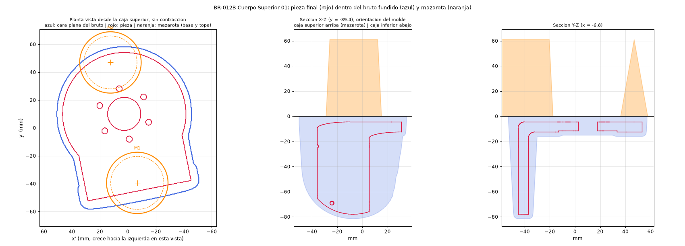
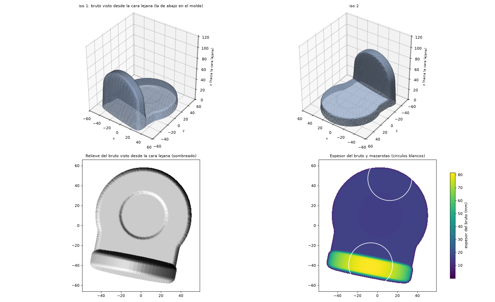

# Patrones para fundición en arena en verde

**Del modelo CAD de una pieza al patrón imprimible y a las mazarotas dimensionadas, para fundir aluminio con ≈ 7 % de silicio en arena en verde artesanal.** Incluye los diez patrones ya calculados, una ficha por pieza con sus decisiones y los scripts en Python con los que se generaron.



> **Estado: preliminar.** Los patrones se calcularon y se revisaron con comprobaciones geométricas, pero **todavía no se ha fundido ninguna pieza con ellos**. No se simuló la solidificación y la aleación del laboratorio no está certificada. Hay que confirmar medidas, mazarotas y cajas con el taller antes de fundir.

## Para qué sirve

Las piezas pertenecen a un reductor cicloidal. Para evaluar su fabricación por fundición de aluminio con patrones impresos en 3D, se automatizó el cálculo: a partir de una malla de la pieza, el programa obtiene el bruto con sobremetal y salida, el patrón escalado por la contracción y las mazarotas. Hacerlo a mano para diez piezas habría sido lento y propenso a errores.

## Reglas de diseño (iguales para las diez piezas)

| Regla | Valor |
| --- | --- |
| Proceso | Arena en verde artesanal, aluminio ≈ 7 % Si |
| Salida (ángulo de desmoldeo) | 3° en todas las paredes |
| Sobremetal | 3 mm mínimo en todas las caras. 4,5 mm en la cara de partición |
| Contracción | 1,3 %, es decir, patrón × 1,013 |
| Radios | 3 mm mínimo en aristas convexas y rincones |
| Agujeros y huecos | Sin machos. Lo menor de Ø24 mm se rellena en el patrón y se mecaniza después. Los huecos grandes pasantes en la dirección de extracción se dejan como islas de arena |
| Dientes de engranes | No se funden. El bruto es el cono envolvente y los dientes se tallan después |

## Resultados

Las dimensiones son: pieza final, bruto sin contraer y patrón ×1,013. El rendimiento es el peso de la pieza en bruto frente al peso de pieza más mazarotas, sin bebedero.

| N.º | Pieza | Pieza (mm, cm³) | Bruto sin contraer (mm, g) | Patrón ×1,013 (mm) | Mazarotas | Rend. |
| --- | --- | --- | --- | --- | --- | --- |
| 01 | [Soporte superior de engranes](piezas/01_Soporte_superior_de_engranes/01_ficha.md) | 65,0 × 17,0 × 27,0; 27,8 | 74,6 × 26,6 × 34,5; 155 | 75,6 × 27,0 × 34,9 | 1 × Ø42→36 × 58 | 46 % |
| 02 | [BR-005 Upper Body RED](piezas/02_BR-005_Upper_Body_RED/02_ficha.md) | 88,0 × 88,0 × 8,0; 21,6 | 96,4 × 96,4 × 16,1; 190 | 97,6 × 97,6 × 16,3 | 2 × Ø29→25 × 40 | 61 % |
| 03 | [BR-006 Input RED](piezas/03_BR-006_Input_RED/03_ficha.md) | 65,0 × 65,0 × 12,5; 14,4 | 72,8 × 72,8 × 20,6; 161 | 73,8 × 73,8 × 20,8 | 1 × Ø36→31 × 50 | 58 % |
| 04 | [BR-012B Cuerpo Superior 01](piezas/04_BR-012B_Cuerpo_Superior_01/04_ficha.md) | 91,7 × 106,2 × 73,5; 87,4 | 101,7 × 116,4 × 81,5; 584 | 103,0 × 117,9 × 82,6 | 2 × Ø44→38 × 61 | 58 % |
| 05 | [Tapa 1 del nuevo contenedor](piezas/05_Tapa_1_del_nuevo_contenedor/05_ficha.md) | 98,0 × 98,0 × 22,0; 88,0 | 107,8 × 107,8 × 30,1; 521 | 109,2 × 109,2 × 30,4 | 2 × Ø45→38 × 62 | 54 % |
| 06 | [Damn side piece](piezas/06_Damn_side_piece/06_ficha.md) | 60,0 × 97,0 × 38,0; 59,9 | 71,6 × 106,8 × 46,0; 494 | 72,5 × 108,2 × 46,6 | 1 × Ø51→43 × 70 | 61 % |
| 07 | [BR-030 y BR-031, cónico menor y polea](piezas/07_BR-030_y_BR-031_Conico_menor_y_polea/07_ficha.md) | 52,7 × 52,7 × 20,3; 16,3 | 61,2 × 61,2 × 28,4; 160 | 62,0 × 62,0 × 28,8 | 1 × Ø49→42 × 69 | 35 % |
| 08 | [Engrane p1](piezas/08_Engrane_p1/08_ficha.md) | 98,7 × 98,7 × 15,8; 73,8 | 107,2 × 107,2 × 23,9; 465 | 108,6 × 108,6 × 24,2 | 1 × Ø51→43 × 70 | 59 % |
| 09 | [Base de engranajes](piezas/09_Base_de_engranajes/09_ficha.md) | 42,5 × 70,0 × 18,0; 33,3 | 51,5 × 78,3 × 26,1; 220 | 52,1 × 79,3 × 26,4 | 1 × Ø39→33 × 54 | 61 % |
| 10 | [Engrane p2](piezas/10_Engrane_p2/10_ficha.md) | 35,0 × 35,0 × 32,0; 30,1 | 45,7 × 45,7 × 40,0; 157 | 46,3 × 46,3 × 40,6 | 1 × Ø54→47 × 75 | 29 % |

Las mazarotas se escriben como `número × Ø base → Ø tope × alto` en mm.

Notas por pieza:

- **01** se hizo antes con un cálculo directo (prisma con esquinas redondeadas), no con el programa general. Sus scripts están en su carpeta. Los dos agujeros de Ø4,5 mm y los seis de Ø2,5 mm quedan rellenos.
- **02** conserva el hueco central de Ø62 mm como isla de arena.
- **04** es una pieza en L: el bruto pesa 2,6 veces la pieza y la caja inferior debe tener al menos 112 mm de alto. La alternativa con menos mecanizado es un patrón partido, que no se hizo.
- **05** tiene el interior de la tapa abierto hacia abajo, que forma una isla de arena.
- **06** tiene la cavidad rellena: el bruto pesa 3,2 veces la pieza.
- **07, 08 y 10** son engranes o conos. El rendimiento de la 10 es bajo (29 %) porque la pieza es compacta.
- **09** conserva su ventana central.

## Cómo se calcula cada patrón

El programa `herramientas/process_piece.py` hace lo siguiente a partir de una malla STL de la pieza:

1. **Mapa de alturas.** Toma la altura de la pieza en la dirección de extracción y rellena los huecos y entallas menores de 24 mm. Si no se indica otra, elige la dirección de extracción con menor volumen de bruto entre las seis posibles.
2. **Sobremetal y salida.** Dilata ese mapa con un elemento estructurante que da el sobremetal en todas las caras y la salida exacta. Los bordes convexos quedan redondeados con radio igual al sobremetal.
3. **Partición y contracción.** Recorta en el plano de partición, con 4,5 mm de sobremetal, cierra la malla y la escala × 1,013 para obtener el patrón.
4. **Mazarotas.** Las dimensiona con el módulo de Chvorinov, tomando el módulo de la mazarota como 1,2 veces el de la pieza, y las coloca sobre la zona más gruesa. Calcula el número de mazarotas necesario y el rendimiento. Las alturas mínimas de las cajas están en la ficha de cada pieza.

Es un modelo para decidir y preparar el patrón. No simula la solidificación.



## Cómo usar los patrones

Las instrucciones de impresión están en [`docs/LEEME_IMPRESION.txt`](docs/LEEME_IMPRESION.txt) y la guía de colocación de mazarotas en [`docs/GUIA_MAZAROTAS.pdf`](docs/GUIA_MAZAROTAS.pdf). En resumen:

- Imprime `NN_patron_3grados_x1.013.stl` **sin reescalar**, porque ya incluye la contracción. Se apoya sobre su cara plana, que es el plano de partición, y no necesita soportes.
- Imprime las copias indicadas de `NN_mazarota_forma.stl`, que es un tronco de cono, con la base ancha sobre la cama.
- Cada ficha (`NN_ficha.md`) trae la orientación, los huecos rellenados o conservados, la posición de las mazarotas, las cajas mínimas y las observaciones. `NN_comprobacion.png` muestra la pieza dentro del bruto con las mazarotas en planta y en sección.

## Regenerar un patrón

Necesitas Python y estos paquetes. Se desarrolló con Python 3.11, CadQuery 2.8.0, NumPy 2.4.6, SciPy 1.17.1, Matplotlib 3.11.2 y scikit-image 0.26.0.

```powershell
py -3.11 -m venv .venv
.\.venv\Scripts\python.exe -m pip install -r requirements.txt

# 1) STEP → un STL por sólido
.\.venv\Scripts\python.exe herramientas\s2m.py "mi_pieza.STEP" mallas

# 2) STL → bruto, patrón y mazarotas
.\.venv\Scripts\python.exe herramientas\process_piece.py --mesh mallas\mi_pieza_0.stl --outdir salida --tag 11 --name "Mi pieza"
```

Las opciones de `process_piece.py` están en [`herramientas/LEEME.md`](herramientas/LEEME.md). No se incluyen los archivos STEP de las piezas originales, así que para reproducir los diez patrones se necesitan esos modelos o la malla de otra pieza propia.

## Estructura

```text
piezas/NN_<nombre>/
├── NN_ficha.md                       decisiones, medidas y mazarotas de la pieza
├── NN_patron_3grados_x1.013.stl      patrón listo para imprimir
├── NN_mazarota_forma.stl             forma de la mazarota
├── NN_comprobacion.png               pieza dentro del bruto, planta y secciones
└── NN_vistas_patron.png              vistas del bruto, relieve y espesor
herramientas/                         s2m.py, process_piece.py, hfcast.py
docs/                                 RESUMEN.md, GUIA_MAZAROTAS.pdf, LEEME_IMPRESION.txt
```

La carpeta `piezas/01_Soporte_superior_de_engranes/` incluye además el bruto sin contraer y los dos scripts con los que se hizo esa pieza.

## Límites

- Preliminar y sin ensayo físico. Ninguna pieza se ha fundido todavía.
- Los valores de contracción, sobremetal y mazarotas son típicos de arena en verde artesanal. No se midieron con la aleación del laboratorio.
- Los dientes de los engranes no están en los patrones.
- No hay licencia declarada todavía, así que el código y los modelos no pueden reutilizarse mientras no se elija una.

**Desarrollo:** [@Aleccart](https://github.com/Aleccart)
